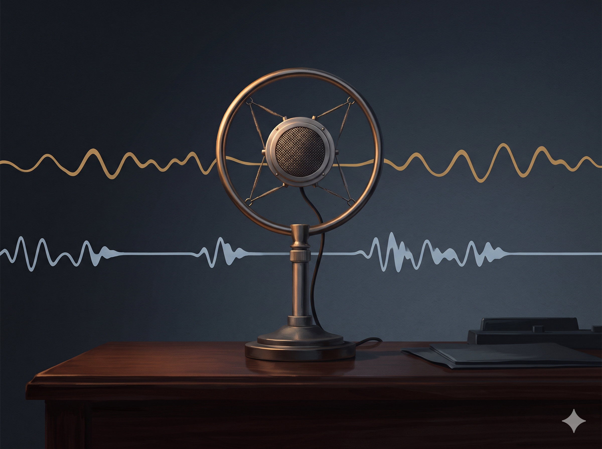

# The King's Speech

In *The King's Speech* (2010), directed by Tom Hooper, the second movement of Beethoven's *Symphony No. 7* accompanies [King George VI's radio address](https://www.youtube.com/watch?v=92upyRGrn44). Its recurring rhythm begins in the lower strings, and the sound gradually gains weight as other parts join. This steady pulse contrasts with his speech, which repeatedly pauses. What stayed with me more than the growing music was the silence before his next words. The soundtrack does not stop, but the absence of his voice makes those brief gaps feel unusually long. Rather than simply hiding his difficulty, the music seems to make me wait and listen more closely. As the music swells, however, that waiting begins to take on a different meaning: the pauses can sound like obstacles on the way to a successful conclusion, and finishing the speech becomes a moving victory. Because a person who stutters should not have to speak fluently to earn respect, I think this framing deserves questioning. Beethoven's music was not chosen by George VI to express his experience; it is part of the film's way of shaping the audience's response. This can be read alongside [an analysis of *Sound of Metal*](./choi-seeun.md), which interprets silence as part of accepting disability rather than overcoming it. Reading the two together raises a question about whether silence is merely a gap to be overcome or part of an experience worth attending to. Thinking back to listening as discussed in class, what matters to me is not only whether he completes the speech, but how we listen to the time he needs to say his next words.

# 킹스 스피치

톰 후퍼 감독의 킹스 스피치(2010)에서 [조지 6세가 라디오 연설을 하는 장면](https://www.youtube.com/watch?v=92upyRGrn44)에는 베토벤의 교향곡 제7번 제2악장이 사용된다. 이 곡은 낮은 현악기의 반복되는 리듬에서 출발해 다른 성부가 겹치며 점차 소리에 무게가 실린다. 이렇게 꾸준히 이어지는 박동은 자꾸 멈추는 그의 말과 대비된다. 음악이 점점 커지는 것보다 내게 더 남았던 것은 다음 말을 꺼내기 전의 침묵이었다. 배경음악은 멈추지 않지만 목소리가 비는 순간에는 그 짧은 틈이 유난히 길게 느껴졌다. 음악이 그의 어려움을 감추기보다는 오히려 다음 말을 기다리며 귀 기울이게 하는 것 같았다. 그런데 음악이 커질수록 이 기다림의 의미도 달라진다. 말 사이의 멈춤이 성공적인 결말을 향해 넘어야 할 장애물처럼 들리고, 연설을 끝마치는 일이 하나의 감동적인 승리로 받아들여질 수 있기 때문이다. 말더듬을 가진 사람이 반드시 유창하게 말해야만 인정받을 수 있는 것은 아니므로, 이런 연출은 조금 다르게 생각해 볼 필요가 있다. 더구나 베토벤의 음악은 조지 6세가 자신의 경험을 표현하기 위해 선택한 곡이 아니라 관객의 반응을 이끄는 영화의 장치다. 이 점은 침묵을 장애의 극복보다 수용의 관점에서 해석한 [사운드 오브 메탈에 관한 글](./choi-seeun.md)과 함께 읽어 볼 수 있다. 두 글을 연결하면 침묵이 단지 넘어야 할 공백인지, 그 자체로 주의를 기울여야 할 경험인지 질문하게 된다. 수업에서 배운 청취를 떠올려 보면, 내게 중요한 것은 연설을 끝까지 해냈는지만이 아니라 그가 다음 말을 꺼내는 데 필요한 시간을 우리가 어떻게 듣는가이다.
